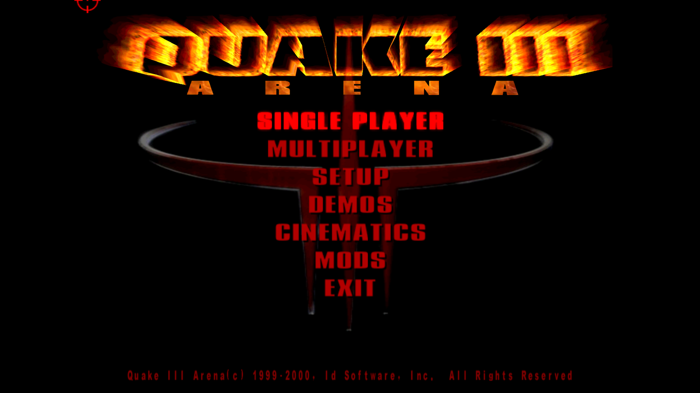
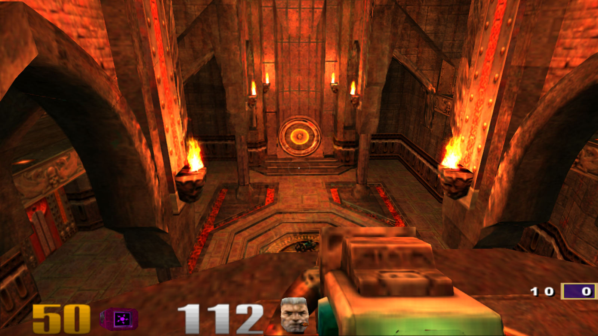
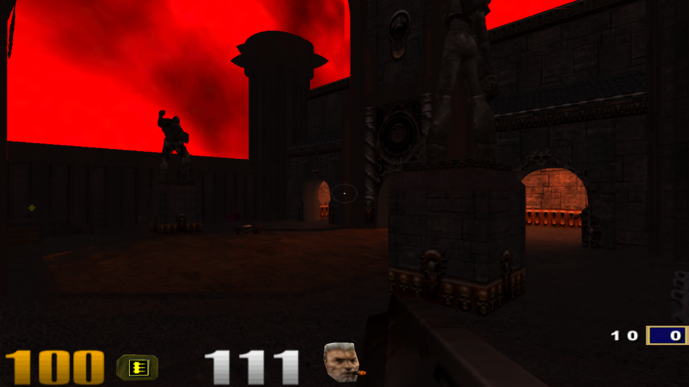

# Vulkan Quake III NG #

A Linux-focused continuation of **vkq3ng**, the Vulkan/ray-tracing fork of Quake III Arena.

This branch is not vanilla Q3: the renderer has been moved to a modern Vulkan path, the Linux
platform layer now speaks native Wayland and PipeWire, and the RTX renderer uses the
cross-vendor Khronos ray-tracing API instead of NVIDIA-only extensions.

It still uses your own Quake III Arena data files. No game assets are included.



## What this fork adds

- **Native Wayland** windowing via `xdg-shell`, with relative-pointer and pointer-constraints
  support for mouse capture. X11/GLX remains available as a fallback.
- **PipeWire audio** backend, with the old OSS path kept only as a compile-time fallback.
- **Vulkan renderer** with raster and path-traced modes.
- **Cross-vendor ray tracing** through `VK_KHR_acceleration_structure`,
  `VK_KHR_ray_tracing_pipeline`, and `VK_KHR_buffer_device_address` — not
  `VK_NV_ray_tracing`.
- **NVIDIA DLSS** when the driver-provided NGX DLSS runtime is available.
- **AMD FidelityFX Super Resolution 2 (FSR2)** as the cross-vendor temporal upscaler,
  with no extra runtime dependency.
- **NVIDIA Reflex + Boost** through `VK_NV_low_latency2`, with graceful fallback elsewhere.
- **Adaptive internal resolution** with frame-time feedback, plus EASU (FSR1 spatial)
  upscaling as a vendor-neutral fallback.
- **Growable zone allocator** so large HD texture packs are not limited by the original
  fixed-size zone.
- **Repaired Linux build**: submodules, shader generation, strict-compiler fixes, and
  Vulkan/RTX resource lifetime fixes.

## Screenshots

| RTX path tracing — `q3dm8` | RTX path tracing — `q3dm1` |
|:--:|:--:|
|  |  |

Screenshots are from the current `vkq3ng` build. RTX was rendered with DLSS and Reflex
enabled; the HUD and weapon are part of normal gameplay.

## Requirements

### Linux

- x86_64 Linux
- CMake **3.14+**
- A C compiler and `make`/Ninja
- Vulkan **1.2+** loader and headers
- Wayland client libraries, `wayland-protocols`, and `xkbcommon` for the native backend
- PipeWire development headers for the PipeWire audio backend
- X11 development headers for the fallback window path and legacy GLX renderer

Ubuntu/Kubuntu package list:

```bash
sudo apt update
sudo apt install \
  build-essential cmake git pkg-config \
  libvulkan-dev vulkan-tools \
  libwayland-dev wayland-protocols libxkbcommon-dev \
  libpipewire-0.3-dev \
  libx11-dev libxext-dev libxxf86vm-dev libxxf86dga-dev \
  libgl1-mesa-dev
```

### GPU / driver

The raster Vulkan path runs on any Vulkan 1.2-capable GPU. The RTX path additionally needs:

- `VK_KHR_acceleration_structure`
- `VK_KHR_ray_tracing_pipeline`
- `VK_KHR_buffer_device_address`
- `VK_KHR_deferred_host_operations`
- `VK_KHR_spirv_1_4` and `VK_KHR_shader_float_controls`

That covers NVIDIA RTX, AMD RDNA2+, and Intel Arc-class hardware with a suitable driver.
If the device does not expose the KHR ray-tracing set, the renderer automatically falls
back to raster Vulkan.

DLSS is NVIDIA-only and requires the NGX DLSS runtime installed by the NVIDIA driver.
The renderer does not redistribute it; without it, DLSS is skipped and FSR2 is used.
FSR2 is compiled into the renderer and works on any Vulkan 1.2 device with the KHR ray-tracing
extensions, including AMD and Intel GPUs.
Reflex likewise requires `VK_NV_low_latency2` and falls back cleanly when absent.

## Build

```bash
git clone https://github.com/kubuntugamer/vkq3ng.git
cd vkq3ng
git checkout reforged
git submodule update --init --recursive

cmake -S . -B _project -DCMAKE_BUILD_TYPE=RelWithDebInfo
cmake --build _project -j"$(nproc)"
```

The game binary is written to:

```text
bin/quake3
```

The UI, cgame, and game modules are built alongside it in `bin/`.

> The original Windows build still exists, but Linux is the maintained target of this fork.

## Game data

This repository contains source code only. You must provide your own Quake III Arena
installation, or buy the game from
[Steam](https://store.steampowered.com/app/2200/Quake_III_Arena/) or
[GOG](https://www.gog.com/en/game/quake_iii_gold).

A minimal layout looks like this:

```text
Quake3/
└── baseq3/
    ├── pak0.pk3
    ├── ...
    ├── pak8.pk3
    ├── q3key
    └── blue_noise_textures/
        └── 256_256/
            ├── HDR_RGBA_0000.png
            └── ...
```

Copy the repository's `blue_noise_textures` directory into `baseq3`:

```bash
cp -r blue_noise_textures /path/to/Quake3/baseq3/
```

The RTX renderer needs those textures. They are CC0; the original set is published at
[Blue Noise Textures](https://momentsingraphics.de/BlueNoise.html). Place your own `q3key`
in `baseq3/` as well; it is the same file used by the original game.

### Optional HD texture packs

These are loaded as additional `.pk3` files in `baseq3`. They are **not** bundled here
because their licenses are separate from the GPL source code. Download them from their
authors and follow the terms on those pages:

| Pack | Link | Notes |
|---|---|---|
| Q3Q HD Upscale 3x | [GitHub release](https://github.com/Dteyn/Q3Q_HD_Textures/releases/tag/v0.3-beta) | AI upscale with RealESRGAN Vulkan; keeps the original look |
| Runo HD Textures | [ModDB](https://www.moddb.com/mods/quake-iii-arena-remastered-runo-edition/addons/runo-hd-textures) | Hand-modified Quake Live-style textures, skies, and some models |
| XCSV HiRes | [ioquake3 replacement content](https://ioquake3.org/extras/replacement_content/) | Classic hand-made pack; CC BY-NC-ND 3.0 |
| Quake 3 Neural Upscale | [ModDB](https://www.moddb.com/mods/quake-3-neural-upscale/addons) | Very high-resolution AI upscale; split across several `.pk3` files |

Download the `.pk3` files and place them in `baseq3`. Do not commit them to this repository.
Their availability and licensing are controlled by their authors, not by this project.

The rewritten zone allocator grows on demand, so large packs that exceed the original
16 MB zone can load.

## Running

Start the main menu:

```bash
./bin/quake3 \
  +set fs_basePath "/path/to/Quake3" \
  +set fs_homePath "$HOME/.q3a"
```

Start directly on a map:

```bash
./bin/quake3 \
  +set fs_basePath "/path/to/Quake3" \
  +set fs_homePath "$HOME/.q3a" \
  +map q3dm1
```

On Wayland the Linux build defaults to the Vulkan renderer. On X11 it defaults to the
legacy OpenGL path; force Vulkan with:

```bash
+set r_glDriver libvulkan.1
```

### RTX path tracing

In this fork, the legacy `r_vertexLight` cvar also selects the renderer mode:

```bash
# RTX path tracing
./bin/quake3 +set fs_basePath "/path/to/Quake3" +set fs_homePath "$HOME/.q3a" \
  +set r_vertexLight 2

# Raster Vulkan / legacy lighting
./bin/quake3 +set fs_basePath "/path/to/Quake3" +set fs_homePath "$HOME/.q3a" \
  +set r_vertexLight 0
```

Use `r_vertexLight 2` for RTX, not `1`. The RTX path is selected at renderer startup.

A typical RTX launch with all optional features enabled:

```bash
./bin/quake3 \
  +set fs_basePath "/path/to/Quake3" \
  +set fs_homePath "$HOME/.q3a" \
  +set r_vertexLight 2 \
  +set r_dlss 1 \
  +set r_reflex 1 \
  +set r_reflexBoost 1 \
  +set r_fullscreen 1
```

## Renderer and audio options

| Cvar | Default | Meaning |
|---|---:|---|
| `r_vertexLight` | `0` | `0` = raster/legacy lighting, `2` = RTX path tracing |
| `r_dlss` | `1` | Use DLSS when the NGX DLSS runtime is available |
| `r_fsr2` | `1` | Use FSR2 when DLSS is unavailable |
| `r_upscaler` | `1` | `1` = EASU (FSR1 spatial), `0` = bilinear |
| `r_rtxAdaptive` | `1` | Adapt internal render resolution to frame time |
| `r_rtxMaxPixels` | `0` | Auto pixel ceiling; `0` lets the renderer choose |
| `r_reflex` | `1` | Enable NVIDIA Reflex low-latency mode |
| `r_reflexBoost` | `1` | Enable Reflex Boost |
| `r_fullscreen` | archived | Fullscreen mode |
| `r_mode` | archived | Resolution mode |
| `s_initsound` | `1` | Enable sound |
| `snddevice` | `pipewire` | Audio backend name on Linux |

DLSS takes priority when it is available; otherwise FSR2 is selected. If neither temporal
upscaler is active, adaptive resolution plus EASU remains the fallback. Reflex is skipped
without disabling the renderer when `VK_NV_low_latency2` is unavailable.

## Multi-GPU / headless RTX

If the display is connected to an integrated GPU but the RTX card is present as a headless
render device, force the NVIDIA Vulkan ICD for the game process:

```bash
VK_ICD_FILENAMES=/usr/share/vulkan/icd.d/nvidia_icd.json ./bin/quake3 ...
```

For a normal PRIME render-offload setup on X11, the usual `__NV_PRIME_RENDER_OFFLOAD=1`
environment can be used. The renderer enumerates KHR ray-tracing devices and picks the
first suitable one; if no RT-capable device is found, it falls back to raster.

## Troubleshooting

**No audio**

```bash
wpctl status
pactl list sink-inputs
```

Make sure the game was started with `+set s_initsound 1` and, on PipeWire,
`+set snddevice pipewire`.

**RTX is not active**

Check the startup log for:

```text
Vulkan: KHR ray tracing pipeline enabled
```

Also confirm `r_vertexLight 2` and that the selected GPU exposes the KHR ray-tracing
extensions (`vulkaninfo | grep -i ray_tracing`).

**Wayland backend not used**

Check `echo "$WAYLAND_DISPLAY"` and make sure `libwayland-dev`, `wayland-protocols`, and
`libxkbcommon-dev` were present when CMake configured the build. Without them the build
uses the X11 path.

**Missing CD key**

Place your own `q3key` in `baseq3/`. The original Quake III key file is required by the
classic UI.

**Large HD texture pack does not load**

The zone allocator now grows in segments; no extra cvar is required. Make sure the pack's
`.pk3` files are in the `baseq3` directory selected by `fs_basePath`.

## Asset and source licensing

The engine source is derived from id Software's GPL Quake III Arena release. See `COPYING`
and the licenses of the bundled third-party libraries. The FSR2 backend and its generated
Vulkan shader blobs are derived from AMD FidelityFX FSR2 2.2.1 under the MIT license; see
`code/renderer/fsr2/LICENSE.txt`.

Quake III Arena game data, `q3key`, and third-party HD texture packs are **not** part of
this repository. They remain the property of their respective owners and must be obtained
separately under their own terms. Screenshots in this README were captured from the
current build using the base game assets.
